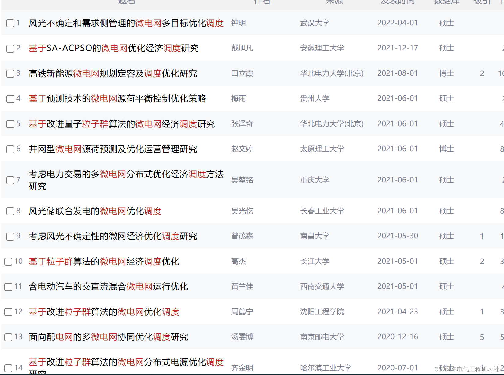
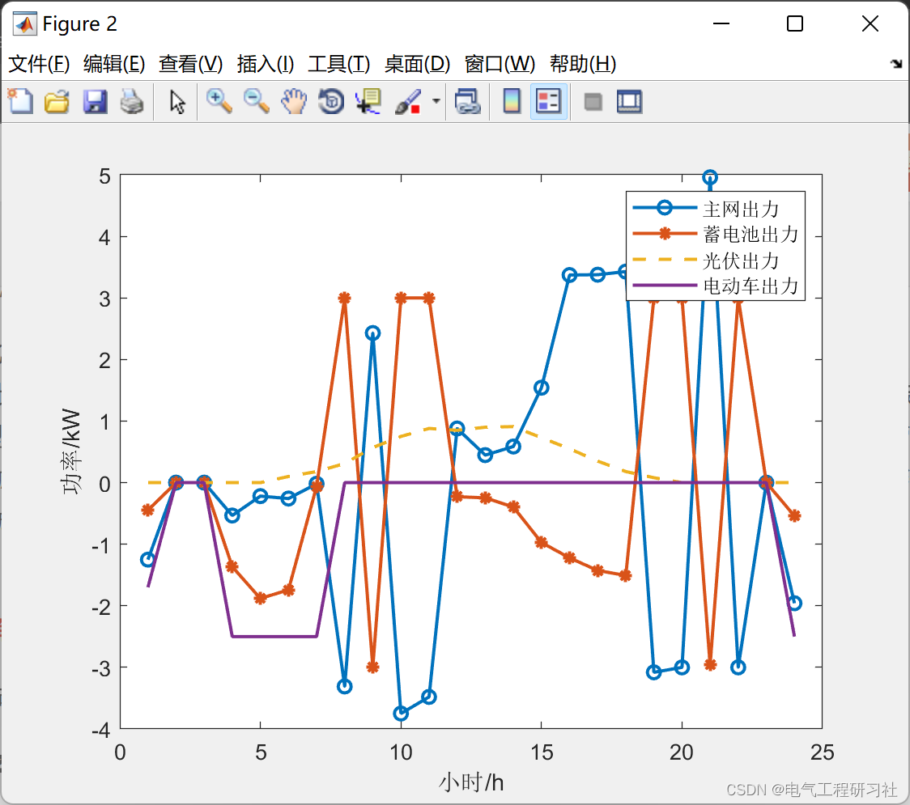
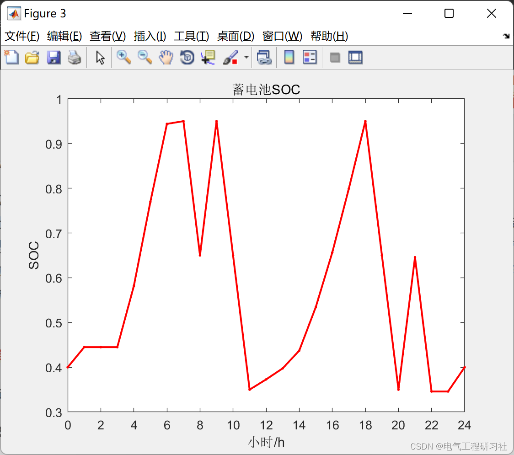
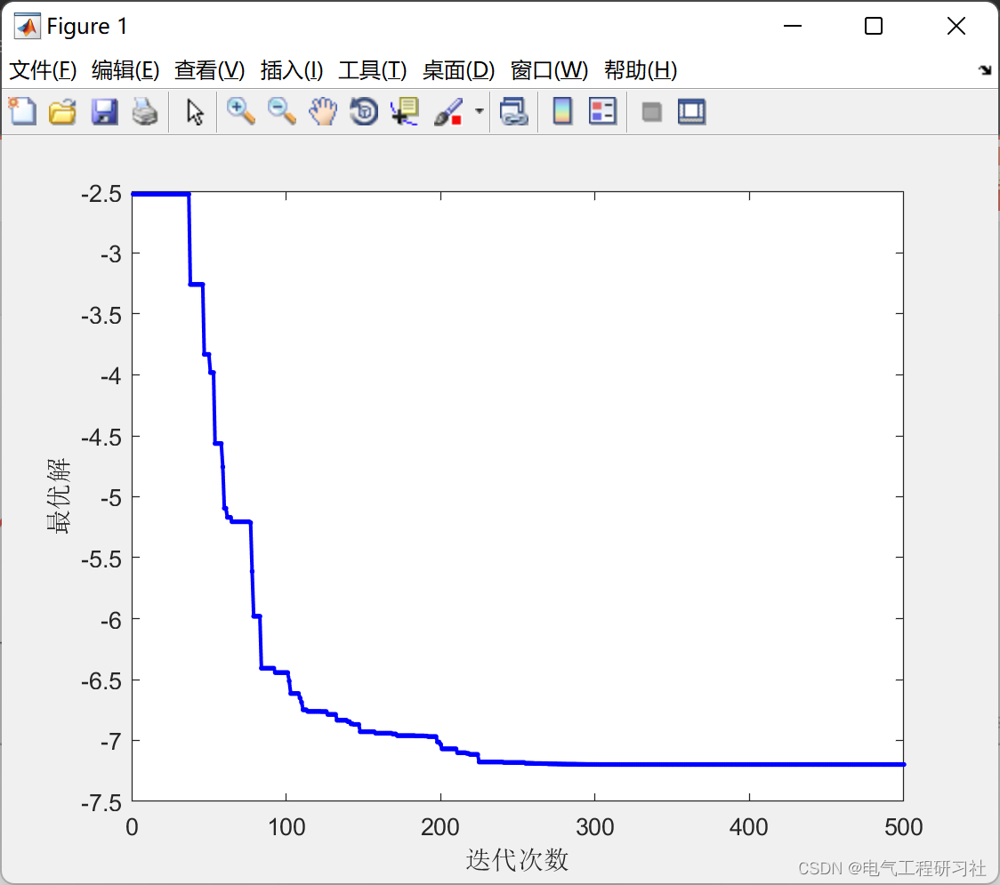

# Microgrid Dispatching Based on Particle Swarm Optimization Algorithm (Photovoltaic, Energy Storage, Electric Vehicles, Interaction with the Grid) (Matlab Code Implementation)

​  
This article is organized as follows: ⛳️⛳️⛳️​Contents 1. Overview 2. Particle Swarm Optimization-Based Microgrid Scheduling Results 3. MATLAB Code 4. Final Thoughts 1. Overview The economic dispatch problem for microgrids (Micro-Grid) refers to forecasting the conventional load, photovoltaic generation, and electric vehicle power generation for the next 24 hours based on time-of-use electricity prices, then making full use of adjustable means in the microgrid such as energy storage to optimize the economic operation of the microgrid. When the total output of new energy exceeds the total load, new energy sells electricity to the main grid, and when there is a shortage of new energy supply, it buys electricity from the main grid.
Numerous scholars have conducted extensive research on this topic. Considering the correlation between electricity prices and load response volume. Established the lowest operating cost The model that aims to maximize the renewable energy consumption ratio and user satisfaction is a day-ahead dispatching model. In response to the issue of uncertainties in the output of new energy in microgrids, From the perspective of grid-connected microgrid operators, a two-stage day-ahead optimization scheduling framework for supply and demand coordination is proposed to reduce system operational costs and risks. Considering the uncertainty of renewable energy outages, A method for stochastic optimization dispatch of microgrid considering risk is proposed. The objective could also be to minimize operational costs. Considering energy storage at the same time. A model of day-ahead dispatch for microgrids is proposed.
We discussed in the last class: Microgrid scheduling (wind, solar, energy storage, grid interaction) (Matlab & Python code implementation).
Students interested can check it out.
You can also learn related knowledge from CNKI:
Editor
2. Editing results of microgrid dispatching based on Particle Swarm Optimization
Editor
Editor
3. Matlab code: This article only displays a part of the code, the full code can be found in:
% SOC constraint\n     fx(f)=fitnessEcoVir(CFX,grid(f,:),xdccl(f,:),sub,PV,buy,sell);%Fitness update\n% Individual Optimal\n    if fx(f)<fpbest(f)\n        pbest(f,:)=SOC(f,:);\n        fpbest(f)=fx(f);\n    end\n    % Individual Optimality\n    if fx(f)<fgbest\n        gbest=SOC(f,:);\n        fgbest=fx(f);   \n      GRID=grid(f,:);\n    end\n    \n  end\n     MINIMUM(t)=fgbest;  \nend\ndb=gbest;\nfor j=1:24\n    xdc(j)=(gbest(j)-gbest(j+1))*XDCRL;  \nend\n% for j=1:24\n%     GRID(j)=LOAD(j)+Pev(i) - PV(j)- xdc(j);\n% end\n\nGRID  % Power grid\nxdc    % Battery\na=sum(xdc)\n\nfigure(1);\n\nfitgbest=min(MINIMUM)\nplot(MINIMUM,'Color','b','Marker','.','LineWidth',1.5)\nxlabel('Iteration count')\nylabel('Optimal solution')\n\nfigure(2);\nl=1:24;\nplot(l,GRID,'o-',l,xdc,'*-',l,PV,'--',l,Pev,'-','LineWidth',1.5)\nlegend('Main network output power','Battery power','Photovoltaic output','Electric vehicle power')\nxlabel('Hour/h')\nylabel('Power/kW')\n% \n% set(gca,'xtick',0:2:24) \n% hold off\nSOC=db(1:25)\nfigure(2)\nll=0:24;\nfigure(3);\nplot(ll,SOC,'Color','r','Marker','.','LineWidth',1.5)\nxlabel('Hour/h')\nylabel('SOC')\nxlim([0 24])\ntitle('BatterySOC')\nset(gca,'xtick',0:2:24)\n  
4. Conclusion
👨‍🎓Bloggers' extracurricular interests: Eastern and Western philosophies. To the reader:👨‍💻 Doing research. Involving a deep-seated ideological system. Requires researchers to be logically precise. Pursuing diligence and seriousness. But it can't just be about effort. Many times, leverage is more important than effort. Additionally, there should be innovative and inspirational points for looking up at the stars. When the philosopher asks you what science is in class, What is electricity? Do not think these issues are funny. Philosophy is the pursuit of ultimate questions. Search for those questions that are self-evident to children but you cannot answer. In this column, I document some philosophical musings and scientific notes when I have the time: research and philosophy.It is recommended that readers browse the catalog in order, to avoid being suddenly plunged into a dark labyrinth without a way back. It may not reveal all the answers to your questions, but it can certainly raise a cloud of doubts in your mind, which might lead to a different scene of colorful sunsets. If it brings you a heavy rain in the spiritual world, then take this opportunity to wash away the dust on the "truth" that was previously stored there. Perhaps, after the rain, the clear sky will be even more beautiful...🔎🔎🔎 Some theoretical references are cited from online documents, if any infringement is found, please contact the blogger for deletion.
​  

## Images

<!-- PAYMENT_BLOCK -->

## Get this dataset

- Payment link (Stripe): [Buy now](https://buy.stripe.com/3cs8yP7sY87d0vu9AB)
- Payment QR code: 

<!-- /PAYMENT_BLOCK -->
